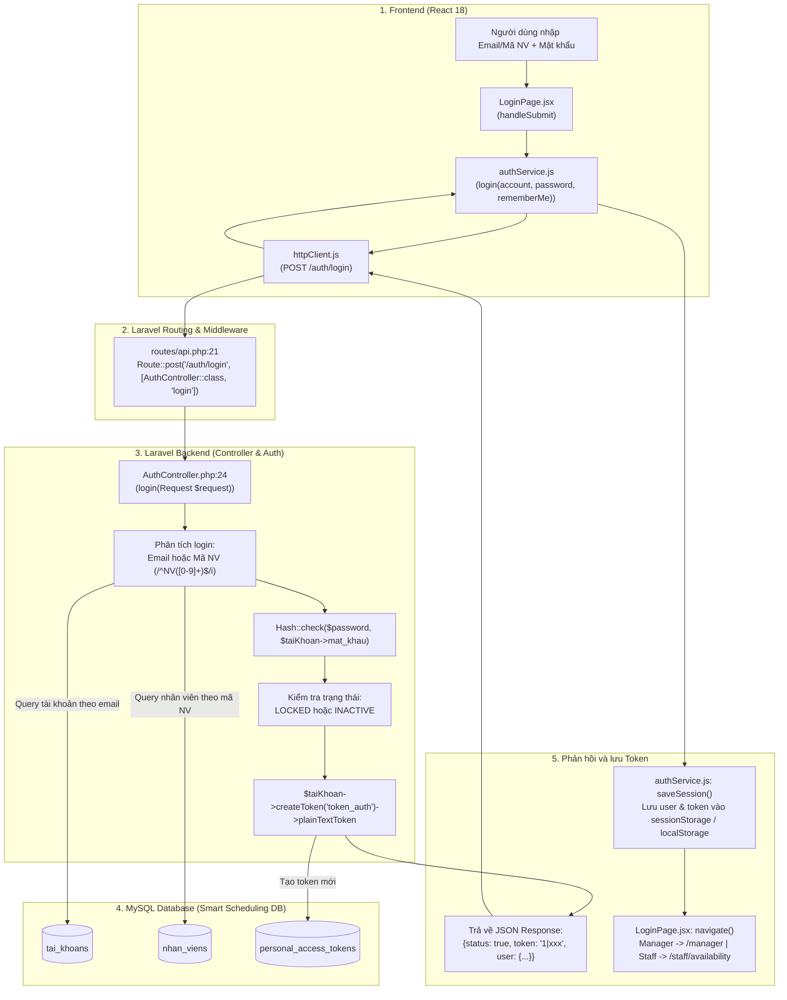
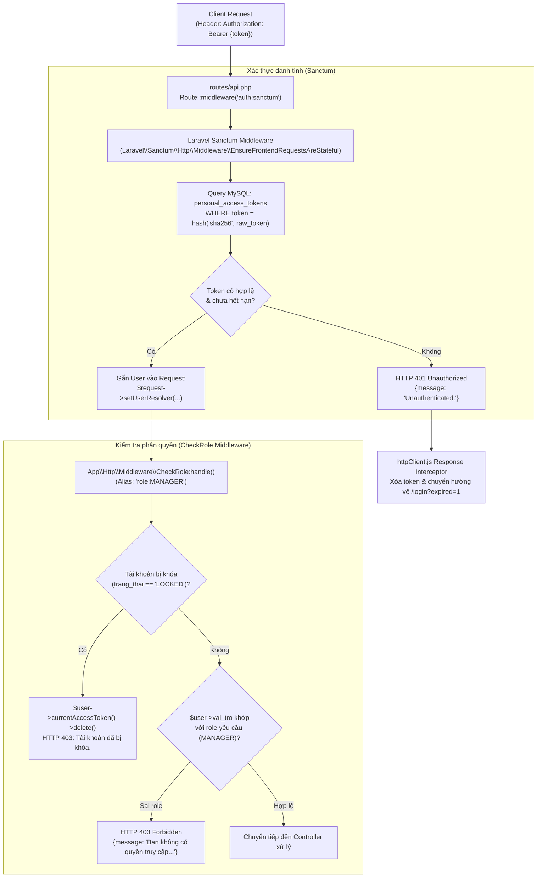
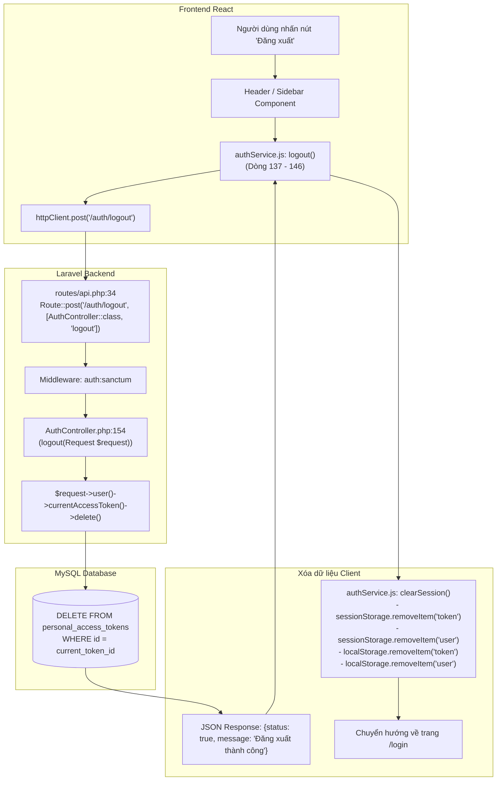

# SƠ ĐỒ ĐƯỜNG ĐI CODE: ĐĂNG NHẬP, ĐĂNG XUẤT VÀ BẢO MẬT TOKEN (AUTHENTICATION & SANCTUM)

Tài liệu này mô tả chi tiết đường đi của code (**Code Flow**) thực tế từ giao diện React đến Backend Laravel và Database MySQL cho hệ thống xác thực của dự án **Smart Scheduling**.

---

## 1. Sơ đồ tổng quan luồng Đăng nhập (Manager & Staff)



---

## 2. Chi tiết từng bước thực thi trong Code

### 2.1. Phía Frontend (Giao diện React)

1. **Bắt đầu tại Component Giao diện:**
   - **File:** `smart-scheduling/src/pages/login/LoginPage.jsx`
   - **Vị trí:** Hàm `handleSubmit(e)` tại **Dòng 91 - 145**.
   - **Hành vi:**
     - Lấy giá trị ô `account` (hỗ trợ nhập email như `manager@smartscheduling.vn` hoặc mã nhân viên `NV001`).
     - Lấy giá trị ô `password`.
     - Kiểm tra định dạng Regex Email hoặc Regex `^nv\d+$`.
     - Gọi hàm `login(cleanAccount, password, rememberMe)` từ `authService.js`.

2. **Dịch vụ Xác thực Frontend:**
   - **File:** `smart-scheduling/src/services/authService.js`
   - **Vị trí:** Hàm `login(account, password, rememberMe = false)` tại **Dòng 93 - 135**.
   - **Hành vi:**
     - Gọi HTTP Client: `httpClient.post("/auth/login", { login: account, email: account, password })`.
     - Nhận response từ server: `{ user, token, message }`.
     - Gọi `saveSession(user, token, rememberMe)` (Dòng 52 - 71) để lưu phiên làm việc:
       - Luôn lưu vào `sessionStorage` (chỉ tồn tại trong tab hiện tại).
       - Nếu người dùng tích chọn *Ghi nhớ đăng nhập* (`rememberMe = true`), lưu thêm bản sao vào `localStorage`.

3. **HTTP Client & Đính kèm Token tự động:**
   - **File:** `smart-scheduling/src/services/httpClient.js`
   - **Vị trí:** Request Interceptor tại **Dòng 8 - 14**.
   - **Hành vi:**
     ```javascript
     httpClient.interceptors.request.use((config) => {
       const token =
         (typeof sessionStorage !== "undefined" && sessionStorage.getItem("token")) ||
         (typeof localStorage !== "undefined" && localStorage.getItem("token"));
       if (token) config.headers.Authorization = `Bearer ${token}`;
       return config;
     });
     ```
     Mọi request tiếp theo (như gọi ca mẫu, xem lịch rảnh, cấu hình ràng buộc) đều tự động mang theo header `Authorization: Bearer <sanctum_token>`.

---

### 2.2. Phía Backend Laravel

1. **Khai báo Route:**
   - **File:** `Be_tao_lich/routes/api.php`
   - **Dòng:** **Line 21**
     ```php
     Route::post('/auth/login', [AuthController::class, 'login']);
     ```
   - **HTTP Method:** `POST`
   - **URL:** `/api/auth/login`
   - **Middleware:** Public (Không yêu cầu token).

2. **Controller xử lý nghiệp vụ:**
   - **File:** `Be_tao_lich/app/Http/Controllers/AuthController.php`
   - **Hàm:** `public function login(Request $request)` tại **Dòng 24 - 132**.
   - **Các bước xác thực:**
     - **Bước 1 (Dòng 26 - 36):** Validate dữ liệu gửi lên:
       - Trường mật khẩu (`password`) là bắt buộc (`required|string`).
       - Nhận định danh đăng nhập từ trường `login`, `email` hoặc `username`.
     - **Bước 2 (Dòng 41 - 70):** Phân tích danh tính kép (Dual Login Identifier):
       - Nếu chuỗi khớp regex `/^NV([0-9]+)$/i` (ví dụ: `NV002`):
         - Tách lấy ID số nguyên: `(int)$matches[1]`.
         - Truy vấn Model `App\Models\NhanVien`: `NhanVien::find($empId)`.
         - Lấy tài khoản liên kết qua khóa ngoại: `$taiKhoan = $nhanVien->taiKhoan`.
       - Nếu chuỗi là email:
         - Truy vấn Model `App\Models\TaiKhoan`: `TaiKhoan::where('email', $login)->first()`.
     - **Bước 3 (Dòng 72 - 84):** Kiểm tra mật khẩu mã hóa:
       - So khớp mật khẩu nhập vào với mật khẩu trong DB bằng `Hash::check($password, $taiKhoan->mat_khau)`.
       - Nếu sai, trả về HTTP `401 Unauthorized` với thông điệp: `"Mật khẩu không chính xác."`.
     - **Bước 4 (Dòng 86 - 98):** Kiểm tra trạng thái hoạt động:
       - Nếu `$taiKhoan->trang_thai === 'LOCKED'`, trả về HTTP `403 Forbidden` (`"Tài khoản của bạn đã bị khóa."`).
       - Nếu nhân viên liên kết có trạng thái `'INACTIVE'` hoặc `'nghi_viec'`, trả về HTTP `403 Forbidden`.
     - **Bước 5 (Dòng 100 - 110):** Sinh Sanctum Token:
       - Gọi phương thức của trait `HasApiTokens`:
         ```php
         $token = $taiKhoan->createToken('token_auth')->plainTextToken;
         ```
       - Sanctum băm token bằng thuật toán SHA-256 và lưu vào bảng `personal_access_tokens`.
     - **Bước 6 (Dòng 112 - 126):** Trả về JSON cho Client:
       ```json
       {
         "status": true,
         "message": "Đăng nhập thành công",
         "token": "3|a8f9c0e2b3...",
         "user": {
           "id": 1,
           "email": "manager@smartscheduling.vn",
           "role": "MANAGER",
           "name": "Quản lý hệ thống",
           "employeeId": "NV001"
         }
       }
       ```

---

## 3. Sơ đồ kiểm tra Token và Phân quyền Middleware (CheckRole & Sanctum)

Khi người dùng gửi request đến các API cần bảo vệ (ví dụ: `/api/shift-config` hoặc `/api/availability/weekly`), request đi qua chuỗi Middleware:



### Chi tiết Middleware:
- **Middleware `auth:sanctum`:**
  - Khai báo tại `Be_tao_lich/routes/api.php:27`: `Route::middleware('auth:sanctum')->group(...)`.
  - Tự động tìm bản ghi token trong bảng `personal_access_tokens`, đối chiếu thời hạn `expires_at` và cập nhật trường `last_used_at`.
- **Middleware `role:MANAGER`:**
  - Khai báo tại `Be_tao_lich/bootstrap/app.php`: Đăng ký alias `'role' => \App\Http\Middleware\CheckRole::class`.
  - Khai báo nhóm route tại `Be_tao_lich/routes/api.php:45`: `Route::middleware('role:MANAGER')->group(...)`.
  - File xử lý: `Be_tao_lich/app/Http/Middleware/CheckRole.php` (Dòng 14 - 45).
  - Kiểm tra trường `$user->vai_tro` trong bảng `tai_khoans`. Nếu giá trị không nằm trong mảng quyền được phép, chặn ngay và trả về HTTP `403`.

---

## 4. Sơ đồ Đăng xuất và Thu hồi Token (Logout Flow)



### Xử lý khi Token hết hạn hoặc không hợp lệ:
- **File:** `smart-scheduling/src/services/httpClient.js`
- **Vị trí:** Response Interceptor tại **Dòng 17 - 38**.
- Khi bất kỳ API nào trả về status `401 Unauthorized` (do token hết hạn, bị thu hồi hoặc giả mạo):
  1. Xóa toàn bộ token và user trong `sessionStorage` và `localStorage`.
  2. Tự động chuyển hướng trình duyệt về:
     ```javascript
     window.location.href = "/login?expired=1";
     ```
  3. Trang `LoginPage.jsx` (Dòng 58) đọc query parameter `expired === "1"` và hiển thị banner thông báo: *"Phiên làm việc đã hết hạn. Vui lòng đăng nhập lại."*

---

## 5. Bảng tổng hợp vị trí Code của luồng Xác thực

| Bước | Thành phần | File thực tế | Hàm / Dòng code | Mục đích |
| :--- | :--- | :--- | :--- | :--- |
| 1 | Form đăng nhập | `smart-scheduling/src/pages/login/LoginPage.jsx` | `handleSubmit()` (L91-145) | Nhận Email/Mã NV + Mật khẩu, validate định dạng |
| 2 | Service đăng nhập | `smart-scheduling/src/services/authService.js` | `login()` (L93-135) | Gửi request POST `/auth/login`, gọi `saveSession()` |
| 3 | Gắn Bearer Token | `smart-scheduling/src/services/httpClient.js` | Request Interceptor (L8-14) | Tự động chèn `Authorization: Bearer <token>` vào mọi API |
| 4 | Xử lý token hết hạn | `smart-scheduling/src/services/httpClient.js` | Response Interceptor (L17-38)| Bắt HTTP 401, xóa session, điều hướng về `/login?expired=1` |
| 5 | Khai báo Route Login | `Be_tao_lich/routes/api.php` | Line 21 | Định tuyến `POST /api/auth/login` tới `AuthController::login` |
| 6 | Controller Login | `Be_tao_lich/app/Http/Controllers/AuthController.php` | `login()` (L24-132) | Xác thực danh tính kép, kiểm tra `Hash::check`, tạo Sanctum token |
| 7 | Middleware Token | `Laravel\Sanctum\Http\Middleware\EnsureFrontendRequestsAreStateful` | Sanctum Core | Đối chiếu token với bảng `personal_access_tokens` |
| 8 | Middleware Phân quyền | `Be_tao_lich/app/Http/Middleware/CheckRole.php` | `handle()` (L14-45) | Kiểm tra `vai_tro === 'MANAGER'`, khóa tài khoản `LOCKED` |
| 9 | Đăng xuất Backend | `Be_tao_lich/app/Http/Controllers/AuthController.php` | `logout()` (L154-167) | Thu hồi và xóa token khỏi bảng `personal_access_tokens` |
| 10 | Bảng tài khoản | MySQL: `tai_khoans` | Schema bảng | Lưu `email`, `mat_khau` (bcrypt), `vai_tro`, `trang_thai` |
| 11 | Bảng nhân viên | MySQL: `nhan_viens` | Schema bảng | Lưu mã NV (id), họ tên, liên kết `tai_khoan_id` |
| 12 | Bảng Token | MySQL: `personal_access_tokens` | Schema bảng Sanctum | Lưu hash của token, `tokenable_id`, `last_used_at` |

