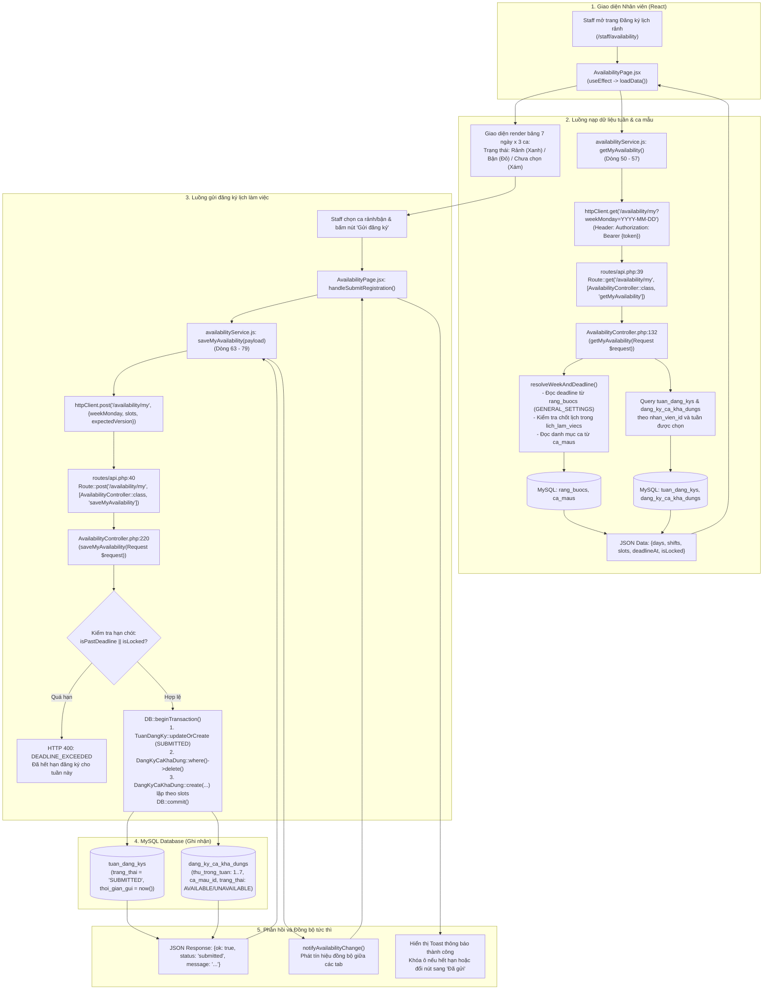

# SƠ ĐỒ ĐƯỜNG ĐI CODE: STAFF ĐĂNG KÝ LỊCH RẢNH / BẬN (STAFF AVAILABILITY FLOW)

Tài liệu này mô tả chi tiết đường đi của code (**Code Flow**) từ giao diện nhân viên (Staff) đến Backend Laravel và Database MySQL cho nghiệp vụ **Đăng ký khả năng làm việc theo tuần (US08)**.

---

## 1. Sơ đồ tổng thể luồng Staff đăng ký lịch rảnh



---

## 2. Chi tiết từng bước thực thi trong Code

### 2.1. Phía Frontend React

1. **Khởi tạo và tải dữ liệu tuần:**
   - **File:** `smart-scheduling/src/pages/employees/availability/AvailabilityPage.jsx`
   - **Hook & Hàm:** `loadData(targetMonday)` tại **Dòng 65 - 80**.
   - **Cơ chế:**
     - Đọc tuần làm việc mục tiêu (ví dụ: `2026-11-09`).
     - Gọi `getMyAvailability({ weekMonday: targetMonday, employeeId })`.
     - Cập nhật State: `setData(res)`, `setSlots(res.slots || {})`, `setInitialSlots(res.slots)`.
     - Đọc tiếp tuần liền trước (`prevWeekMonday`) để hỗ trợ tính năng *"Sao chép từ tuần trước"*.

2. **Dịch vụ gọi API Lấy và Lưu:**
   - **File:** `smart-scheduling/src/services/availabilityService.js`
   - **Hàm `getMyAvailability` (Dòng 50 - 57):**
     ```javascript
     export async function getMyAvailability(params = {}) {
       const { weekMonday } = params;
       const res = await httpClient.get("/availability/my", {
         params: weekMonday ? { weekMonday } : {},
       });
       return res.data?.data || res.data;
     }
     ```
   - **Hàm `saveMyAvailability` (Dòng 63 - 79):**
     ```javascript
     export async function saveMyAvailability(payload = {}) {
       const { weekMonday, slots, expectedVersion } = payload;
       const res = await httpClient.post("/availability/my", {
         weekMonday,
         slots,
         expectedVersion,
       });
       notifyAvailabilityChange(); // Thông báo cập nhật sang màn hình Quản lý
       return res.data;
     }
     ```

3. **Cấu trúc Dữ liệu `slots`:**
   Dữ liệu được tổ chức dưới dạng key-value:
   - Key: `{dayIndex}_{shiftName}` (ví dụ: `0_Sáng` là Thứ 2 Ca Sáng, `6_Tối` là Chủ nhật Ca Tối).
   - Value: `"available"` (Rảnh/sẵn sàng đi làm) hoặc `"busy"` (Bận).

---

### 2.2. Phía Backend Laravel

1. **Khai báo Route:**
   - **File:** `Be_tao_lich/routes/api.php`
   - **Dòng 39 - 40:**
     ```php
     Route::middleware('auth:sanctum')->group(function () {
         Route::get('/availability/my', [AvailabilityController::class, 'getMyAvailability']);
         Route::post('/availability/my', [AvailabilityController::class, 'saveMyAvailability']);
     });
     ```
   - Cả 2 route đều được bảo vệ bởi middleware `auth:sanctum`.

2. **Controller: Xử lý Lấy thông tin đăng ký (`getMyAvailability`):**
   - **File:** `Be_tao_lich/app/Http/Controllers/AvailabilityController.php`
   - **Vị trí:** **Dòng 132 - 214**
   - **Các bước:**
     1. Lấy danh tính người dùng từ token: `$user = $request->user()`.
     2. Truy vấn hồ sơ nhân viên trong bảng `nhan_viens`: `$nhanVien = $user->nhanVien ?? NhanVien::where('tai_khoan_id', $user->tai_khoan_id)->first()`.
     3. Gọi hàm phụ trợ `resolveWeekAndDeadline($weekMonday)` (Dòng 29 - 126):
        - Tính ngày Thứ Hai (`weekMonday`) và Chủ Nhật (`weekSunday`).
        - Đọc cấu hình hạn chót từ bảng `rang_buocs` với `ma_rang_buoc = 'GENERAL_SETTINGS'` (mặc định: Thứ Sáu trước tuần đó lúc 23:59).
        - Kiểm tra bảng `lich_lam_viecs`: nếu tuần này đã được Quản lý chốt lịch (`CONFIRMED`, `PUBLISHED`), đặt `isLocked = true`.
        - Lấy danh sách ca làm việc hoạt động từ bảng `ca_maus` (`whereIn('trang_thai', ['ACTIVE', 'active'])`).
     4. Truy vấn bảng `tuan_dang_kys` kèm theo các ca chi tiết:
        ```php
        $tuan = TuanDangKy::with('dangKyCaKhaDungs')
            ->where('nhan_vien_id', $nhanVien->nhan_vien_id)
            ->where('tu_ngay', $weekMonday)
            ->first();
        ```
     5. Chuyển đổi bản ghi trong bảng `dang_ky_ca_kha_dungs` thành ma trận `slots["{$dayIdx}_{$shiftName}"]`.
     6. Trả về JSON cho Client với đầy đủ thông tin: `slots`, `shifts`, `days`, `deadlineAt`, `isLocked`, `status`.

3. **Controller: Xử lý Lưu đăng ký (`saveMyAvailability`):**
   - **File:** `Be_tao_lich/app/Http/Controllers/AvailabilityController.php`
   - **Vị trí:** **Dòng 220 - 372**
   - **Quy trình kiểm tra và lưu vào Database:**
     - **Bước 1: Kiểm tra Hạn chót (Deadline Guard):**
       ```php
       if ($weekInfo['isPastDeadline'] || $weekInfo['isLocked']) {
           return response()->json([
               'status' => false,
               'code'   => 'DEADLINE_EXCEEDED',
               'message'=> "Đã hết hạn đăng ký cho tuần này (Hạn chót: {$weekInfo['deadlineFormatted']})."
           ], 400);
       }
       ```
     - **Bước 2: Mở Transaction an toàn dữ liệu (`DB::beginTransaction()`):**
       - **Cập nhật tuần đăng ký:** Gọi `TuanDangKy::updateOrCreate(...)` trên bảng `tuan_dang_kys` với `nhan_vien_id`, `tu_ngay = $weekMonday`, cập nhật `trang_thai = 'SUBMITTED'`, `thoi_gian_gui = now()`.
       - **Xóa sạch dữ liệu cũ của tuần này:** Tránh xung đột trùng lặp bản ghi:
         ```php
         DangKyCaKhaDung::where('tuan_dang_ky_id', $tuan->tuan_dang_ky_id)->delete();
         ```
       - **Lưu từng ô ca đăng ký mới:**
         Lặp qua mảng `$rawSlots`, tách chuỗi `dayIndex` và `shiftIdent`. Tìm kiếm mã ID ca trong bảng `ca_maus` và ghi vào bảng `dang_ky_ca_kha_dungs`:
         ```php
         DangKyCaKhaDung::create([
             'tuan_dang_ky_id' => $tuan->tuan_dang_ky_id,
             'ca_mau_id'       => $caMauId,
             'thu_trong_tuan'  => $thuTrongTuan, // 1 (Thứ 2) -> 7 (Chủ nhật)
             'trang_thai'      => ($slotVal === 'available') ? 'AVAILABLE' : 'UNAVAILABLE',
         ]);
         ```
       - **Cam kết lưu trữ:** `DB::commit()`.
     - **Bước 3: Trả về kết quả JSON:**
       HTTP Status `200 OK` với thông điệp: *"Gửi đăng ký lịch rảnh/bận thành công! Dữ liệu đã được cập nhật cho Quản lý."*.

---

## 3. Các bảng MySQL liên quan trực tiếp

| Bảng | Model | Khóa chính / Khóa ngoại | Vai trò trong luồng |
| :--- | :--- | :--- | :--- |
| `nhan_viens` | `App\Models\NhanVien` | `nhan_vien_id`, FK `tai_khoan_id` | Xác định nhân viên đang gửi đăng ký |
| `ca_maus` | `App\Models\CaMau` | `ca_mau_id` | Danh mục ca (Sáng, Chiều, Tối) để đối chiếu ID |
| `rang_buocs` | `App\Models\RangBuoc` | `rang_buoc_id`, code `GENERAL_SETTINGS` | Đọc cấu hình deadline thứ mấy và mấy giờ |
| `lich_lam_viecs` | `App\Models\LichLamViec` | `lich_lam_viec_id` | Kiểm tra xem lịch tuần đã được quản lý chốt hay chưa |
| `tuan_dang_kys` | `App\Models\TuanDangKy` | `tuan_dang_ky_id`, FK `nhan_vien_id` | Lưu trạng thái tuần (`SUBMITTED`), thời gian gửi |
| `dang_ky_ca_kha_dungs` | `App\Models\DangKyCaKhaDung` | `dang_ky_id`, FK `tuan_dang_ky_id`, FK `ca_mau_id` | Lưu trạng thái chi tiết của từng ca: `AVAILABLE` hoặc `UNAVAILABLE` |

