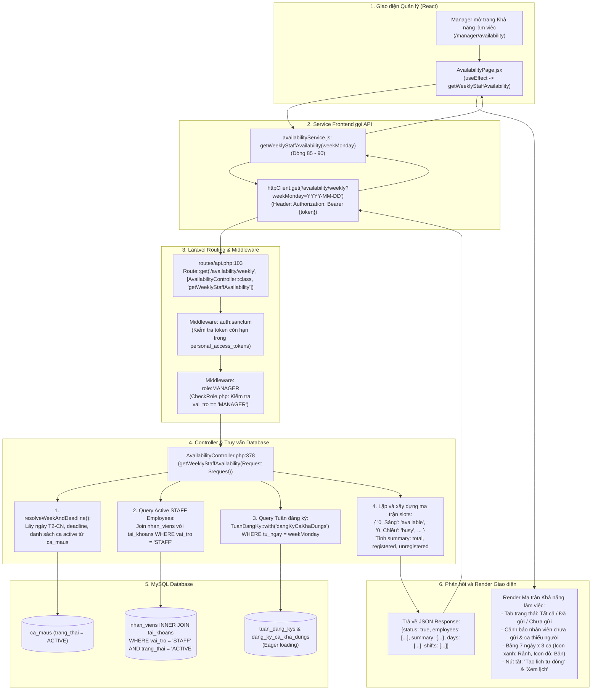

# SƠ ĐỒ ĐƯỜNG ĐI CODE: MANAGER XEM TỔNG HỢP LỊCH RẢNH / BẬN (MANAGER AVAILABILITY FLOW)

Tài liệu này mô tả chi tiết đường đi của code (**Code Flow**) từ giao diện Quản lý (Manager) đến Backend Laravel và Database MySQL cho nghiệp vụ **Quản lý & Tổng hợp khả năng làm việc của nhân viên theo tuần (US09)**.

---

## 1. Sơ đồ tổng thể luồng Manager xem lịch rảnh tuần



---

## 2. Chi tiết từng bước thực thi trong Code

### 2.1. Phía Frontend React

1. **Khởi tạo và tải dữ liệu tuần:**
   - **File:** `smart-scheduling/src/pages/manager/availability/AvailabilityPage.jsx`
   - **Vị trí:** `useEffect` tại **Dòng 309 - 330**.
   - **Cơ chế hoạt động:**
     - Lắng nghe biến tuần `weekMonday` và `refreshKey`.
     - Gọi `getWeeklyStaffAvailability(weekMonday)`.
     - Đồng thời nạp cấu hình ca mẫu `getShiftConfig()` (Dòng 305 - 307) để tính toán cảnh báo ca thiếu người.
     - Lắng nghe sự kiện đồng bộ `subscribeAvailability` (Dòng 24): khi nhân viên ở tab khác nộp lịch, giao diện Manager tự động cập nhật ngay mà không cần tải lại trang.

2. **Dịch vụ gọi API Frontend:**
   - **File:** `smart-scheduling/src/services/availabilityService.js`
   - **Hàm `getWeeklyStaffAvailability` (Dòng 85 - 90):**
     ```javascript
     export async function getWeeklyStaffAvailability(weekMondayIso) {
       const res = await httpClient.get("/availability/weekly", {
         params: weekMondayIso ? { weekMonday: weekMondayIso } : {},
       });
       return res.data?.data || res.data;
     }
     ```

3. **Cơ chế hiển thị và tương tác trên trang:**
   - **Bộ lọc đa chiều (Dòng 357 - 377):**
     - Tìm kiếm theo tên hoặc mã nhân viên (`stripAccents(search)`).
     - Lọc theo chức danh công việc (`roleFilter`: Phục vụ, Pha chế, Thu ngân).
     - Lọc theo trạng thái đăng ký (`statusFilter`: Tất cả / Đã đăng ký / Chưa đăng ký).
   - **Bảng ma trận tuần (AvailabilityTable - Dòng 76 - 290):**
     - Cột cố định (Sticky Columns): Mã NV, Họ tên, Chức danh.
     - 7 cột ngày (Thứ 2 đến Chủ nhật) chia nhỏ thành 3 ca con (Sáng, Chiều, Tối).
     - Icon màu xanh lá (Check) thể hiện ca Rảnh (`available`).
     - Icon màu đỏ (X) thể hiện ca Bận (`busy`).
     - Gạch ngang màu xám thể hiện nhân viên chưa đăng ký hoặc không chọn.
     - 2 cột tổng kết: Tổng số ca rảnh và ca bận của từng nhân viên trong tuần.
   - **Thanh cảnh báo thông minh (NoticeBar - Dòng 423 - 447):**
     - Liệt kê danh sách nhân viên chưa nộp lịch trước hạn chót.
     - Cảnh báo những ca có số lượng nhân viên rảnh thấp hơn nhu cầu tối thiểu.

---

### 2.2. Phía Backend Laravel

1. **Khai báo Route và Kiểm tra quyền:**
   - **File:** `Be_tao_lich/routes/api.php`
   - **Vị trí:** **Line 103** (Nằm trong cụm bảo vệ `role:MANAGER`):
     ```php
     Route::middleware('auth:sanctum')->group(function () {
         Route::middleware('role:MANAGER')->group(function () {
             Route::get('/availability/weekly', [AvailabilityController::class, 'getWeeklyStaffAvailability']);
         });
     });
     ```
   - **Kiểm soát bảo mật:**
     - Token phải hợp lệ trong bảng `personal_access_tokens`.
     - Tài khoản phải có `vai_tro = 'MANAGER'` trong bảng `tai_khoans`. Nếu tài khoản Staff cố gắng gọi API này, Middleware `CheckRole.php` sẽ trả về `403 Forbidden`.

2. **Controller xử lý nghiệp vụ:**
   - **File:** `Be_tao_lich/app/Http/Controllers/AvailabilityController.php`
   - **Hàm:** `public function getWeeklyStaffAvailability(Request $request)` tại **Dòng 378 - 480**.
   - **Quy trình truy vấn và xử lý dữ liệu:**
     - **Bước 1: Chuẩn hóa tuần và hạn chót (Dòng 381):**
       Gọi `resolveWeekAndDeadline($request->query('weekMonday'))` để tính toán chính xác ngày Thứ Hai đến Chủ Nhật.
     - **Bước 2: Truy vấn danh sách nhân viên STAFF hoạt động (Dòng 385 - 392):**
       ```php
       $activeEmployees = NhanVien::join('tai_khoans', 'nhan_viens.tai_khoan_id', '=', 'tai_khoans.tai_khoan_id')
           ->where('tai_khoans.vai_tro', 'STAFF')
           ->whereIn('nhan_viens.trang_thai', ['ACTIVE', 'active', 'Đang làm việc'])
           ->select('nhan_viens.*')
           ->with('roleTag')
           ->orderBy('nhan_viens.nhan_vien_id', 'asc')
           ->get();
       ```
       *Lưu ý bảo mật nghiệp vụ:* Chỉ lấy nhân viên cấp dưới (`STAFF`), tự động loại trừ tài khoản Quản lý (`MANAGER`) khỏi ma trận xếp ca.
     - **Bước 3: Lấy toàn bộ phiếu đăng ký tuần (Dòng 394 - 398):**
       ```php
       $tuanList = TuanDangKy::with('dangKyCaKhaDungs')
           ->where('tu_ngay', $weekMonday)
           ->get()
           ->keyBy('nhan_vien_id');
       ```
       Sử dụng Eager Loading `with('dangKyCaKhaDungs')` để gom toàn bộ dữ liệu chỉ trong 2 câu truy vấn SQL tối ưu (tránh lỗi N+1 Query).
     - **Bước 4: Ghép nối ma trận dữ liệu (Dòng 411 - 470):**
       - Lặp qua từng nhân viên, kiểm tra xem có bản ghi trong `$tuanList` hay không.
       - Nếu có trạng thái `'SUBMITTED'`, duyệt mảng `dangKyCaKhaDungs` để ánh xạ:
         - Khóa ô: `"{dayIdx}_{shiftName}"` (ví dụ: `0_Sáng`).
         - Trạng thái: `'available'` nếu `trang_thai == 'AVAILABLE'`, ngược lại `'busy'`.
         - Cộng dồn các chỉ số tổng hợp: `totalAvailable`, `totalBusy`, `registeredCount`.
     - **Bước 5: Trả về JSON Response hoàn chỉnh:**
       ```json
       {
         "status": true,
         "data": {
           "weekMonday": "2026-11-09",
           "weekLabel": "Tuần 09/11/2026 – 15/11/2026",
           "deadlineFormatted": "23:59 Thứ 6, 06/11/2026",
           "isPastDeadline": false,
           "days": [...],
           "shifts": [...],
           "employees": [
             {
               "id": "NV001",
               "name": "Nguyễn Văn A",
               "role": "Phục vụ",
               "contract": "full_time",
               "registered": true,
               "submittedAt": "2026-11-05T14:20:00+07:00",
               "slots": {
                 "0_Sáng": "available",
                 "0_Chiều": "busy"
               }
             }
           ],
           "summary": {
             "totalEmployees": 15,
             "registeredCount": 12,
             "unregisteredCount": 3,
             "totalAvailableSlots": 140,
             "totalBusySlots": 32
           }
         }
       }
       ```

---

## 3. Các bảng MySQL liên quan trực tiếp

| Bảng MySQL | Model Laravel | Câu truy vấn thực tế | Mục đích sử dụng |
| :--- | :--- | :--- | :--- |
| `nhan_viens` | `App\Models\NhanVien` | `SELECT nhan_viens.* FROM nhan_viens INNER JOIN tai_khoans ...` | Lấy danh sách hồ sơ nhân viên đang làm việc |
| `tai_khoans` | `App\Models\TaiKhoan` | `WHERE tai_khoans.vai_tro = 'STAFF'` | Lọc đúng nhân viên cấp dưới, loại tài khoản Quản lý |
| `role_tags` | `App\Models\RoleTag` | `with('roleTag')` | Lấy tên chức danh (Phục vụ, Thu ngân, Pha chế) |
| `tuan_dang_kys` | `App\Models\TuanDangKy` | `WHERE tu_ngay = 'YYYY-MM-DD'` | Lấy danh sách phiếu gửi đăng ký của tuần |
| `dang_ky_ca_kha_dungs` | `App\Models\DangKyCaKhaDung` | `WHERE tuan_dang_ky_id IN (...)` | Lấy trạng thái rảnh/bận của từng ca trong tuần |
| `ca_maus` | `App\Models\CaMau` | `WHERE trang_thai = 'ACTIVE'` | Lấy danh mục ca để làm tiêu đề cột con |
| `personal_access_tokens`| `Sanctum Token` | `WHERE token = hash(...)` | Xác thực phiên đăng nhập của Manager |

