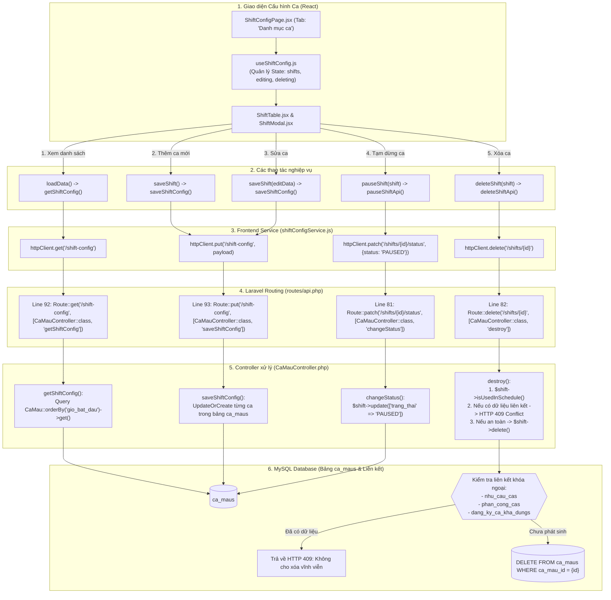
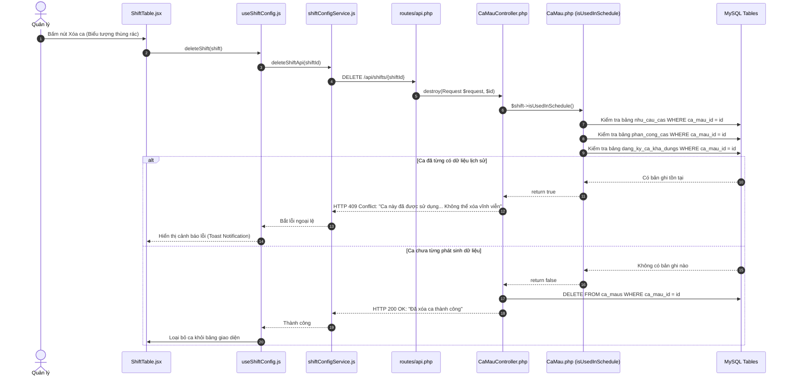

# SƠ ĐỒ ĐƯỜNG ĐI CODE: QUẢN LÝ CA MẪU (SHIFT CONFIGURATION FLOW)

Tài liệu này mô tả chi tiết đường đi của code (**Code Flow**) từ giao diện React đến Backend Laravel và Database MySQL cho toàn bộ các thao tác: **Xem danh sách, Thêm mới, Chỉnh sửa, Tạm dừng trạng thái và Xóa ca mẫu**.

---

## 1. Sơ đồ tổng thể các thao tác Ca mẫu



---

## 2. Chi tiết từng thao tác trong Code

### 2.1. Thao tác 1: Hiển thị danh sách ca mẫu

1. **Frontend:**
   - **File:** `smart-scheduling/src/pages/manager/shiftconfig/hooks/useShiftConfig.js`
   - **Hàm:** `loadData()` tại **Dòng 52 - 72**.
   - **Gọi API:** Gọi `getShiftConfig()` từ `shiftConfigService.js` $\rightarrow$ `GET /api/shift-config`.
   - **Xử lý dữ liệu:** Nhận mảng ca mẫu từ backend, qua hàm chuyển đổi `fromPayload(data)` để ánh xạ các trường (chuẩn hóa `startTime`, `endTime`, `duration_formatted`, `status`).

2. **Backend:**
   - **Route:** `Be_tao_lich/routes/api.php:92`
     ```php
     Route::get('/shift-config', [CaMauController::class, 'getShiftConfig']);
     ```
     *(Cũng có thể gọi qua RESTful endpoint dòng 76: `Route::get('/shifts', [CaMauController::class, 'index']);`)*.
   - **Controller:** `CaMauController.php` hàm `getShiftConfig` (**Dòng 441 - 477**).
   - **Truy vấn DB:**
     ```php
     $shifts = CaMau::orderBy('gio_bat_dau', 'asc')->get()->map(fn($s) => $this->formatShift($s));
     ```
   - **Hàm `formatShift` (Dòng 17 - 56):** Tự động tính toán trường `is_overnight` (ca qua đêm), định dạng giờ `HH:mm`, và gọi `$item->isUsedInSchedule()` để xác định cờ `is_used`.

---

### 2.2. Thao tác 2 & 3: Thêm mới và Chỉnh sửa ca mẫu

1. **Frontend:**
   - **Component Modal:** `smart-scheduling/src/pages/manager/shiftconfig/components/ShiftModal.jsx`.
   - **Hook xử lý:** Hàm `saveShift(data)` trong `useShiftConfig.js` tại **Dòng 167 - 185**.
   - **Cơ chế:**
     - Nếu tạo mới: Tạo mã ca tự động `code = generateShiftCode()`, thêm vào danh sách ca hiện tại.
     - Nếu cập nhật: Tìm ca theo `id` và ghi đè các trường tên ca, giờ bắt đầu, giờ kết thúc, hệ số lương.
     - Gọi hàm `persist(...)` gửi toàn bộ cấu hình lên API:
       ```javascript
       await saveShiftConfig(toPayload(nextShifts, constraints, generalSettings));
       ```

2. **Backend:**
   - **Route:** `Be_tao_lich/routes/api.php:93`
     ```php
     Route::put('/shift-config', [CaMauController::class, 'saveShiftConfig']);
     ```
     *(Hệ thống cũng hỗ trợ endpoint RESTful độc lập tại Line 77: `POST /api/shifts` và Line 79: `PUT /api/shifts/{id}` qua `CreateCaMauRequest` / `UpdateCaMauRequest`)*.
   - **Controller:** `CaMauController.php` hàm `saveShiftConfig` (**Dòng 533 - 577**).
   - **Cơ chế lưu Database:**
     - Mở Transaction: `DB::beginTransaction()`.
     - Lặp qua mảng `shifts` từ request:
       - Nếu có ID số nguyên hợp lệ: Tìm và cập nhật bản ghi trong bảng `ca_maus` (`$shift->update([...])`).
       - Nếu ca mới: Thêm bản ghi mới `CaMau::create([...])`.
     - Lưu các trường: `ten_ca`, `gio_bat_dau`, `gio_ket_thuc`, `he_so_luong`, `trang_thai = 'ACTIVE'`.
     - `DB::commit()`.

---

### 2.3. Thao tác 4: Tạm dừng ca mẫu (Pause Shift)

1. **Frontend:**
   - **File:** `smart-scheduling/src/pages/manager/shiftconfig/hooks/useShiftConfig.js`
   - **Hàm:** `pauseShift(shift)` tại **Dòng 187 - 200**.
   - **Gọi API:** Gọi `pauseShiftApi(shift.id)` trong `shiftConfigService.js` (Dòng 102 - 105) $\rightarrow$ `PATCH /api/shifts/{id}/status` với body `{ status: "PAUSED" }`.
   - **Cập nhật UI:** Đổi trạng thái ca trong state React thành `'paused'`, hiển thị Toast thông báo: *"Đã chuyển ca sang tạm dừng"*.

2. **Backend:**
   - **Route:** `Be_tao_lich/routes/api.php:81`
     ```php
     Route::patch('/shifts/{id}/status', [CaMauController::class, 'changeStatus']);
     ```
   - **Controller:** `CaMauController.php` hàm `changeStatus` (**Dòng 307 - 355**).
   - **Xử lý:**
     ```php
     $shift = CaMau::find($shiftId);
     $shift->update(['trang_thai' => 'PAUSED']);
     ```
   - Trả về JSON thành công với ca mẫu đã được cập nhật.

---

### 2.4. Thao tác 5: Xóa ca mẫu (Có kiểm tra bảo vệ toàn vẹn dữ liệu)

Đây là thao tác có cơ chế bảo vệ nghiêm ngặt để không làm mất tính toàn vẹn dữ liệu:



1. **Frontend:**
   - **File:** `smart-scheduling/src/pages/manager/shiftconfig/hooks/useShiftConfig.js`
   - **Hàm:** `deleteShift(shift)` tại **Dòng 201 - 214**.
   - **Gọi Service:** `deleteShiftApi(shift.id)` trong `shiftConfigService.js` (Dòng 93 - 96).

2. **Backend:**
   - **Route:** `Be_tao_lich/routes/api.php:82`
     ```php
     Route::delete('/shifts/{id}', [CaMauController::class, 'destroy']);
     ```
   - **Controller:** `CaMauController.php` hàm `destroy` (**Dòng 275 - 305**).
   - **Logic kiểm tra toàn vẹn dữ liệu (Dòng 289 - 296):**
     ```php
     if ($shift->isUsedInSchedule()) {
         return response()->json([
             'status'  => false,
             'message' => 'Ca này đã được sử dụng trong nhu cầu ca, lịch làm việc hoặc phân công. Không thể xóa vĩnh viễn để bảo vệ toàn vẹn dữ liệu. Vui lòng chuyển sang trạng thái Tạm dừng.',
             'is_used' => true,
         ], 409);
     }
     $shift->delete();
     ```
   - **Hàm `isUsedInSchedule()` trong Model `CaMau.php`:**
     - Truy vấn bảng `nhu_cau_cas` xem ca có trong nhu cầu tuyển dụng không.
     - Truy vấn bảng `phan_cong_cas` xem ca đã có nhân viên đi làm chưa.
     - Truy vấn bảng `dang_ky_ca_kha_dungs` xem nhân viên đã từng đăng ký ca này chưa.
     - Nếu bất kỳ bảng nào có dữ liệu $\rightarrow$ Trả về `true`, chặn xóa ngay lập tức.

---

## 3. Bảng tổng hợp các trường trong Database MySQL

**Bảng: `ca_maus`**

| Tên cột | Kiểu dữ liệu | Ràng buộc | Mô tả |
| :--- | :--- | :--- | :--- |
| `ca_mau_id` | INT | PRIMARY KEY, AUTO_INCREMENT | Mã định danh ca mẫu |
| `ten_ca` | VARCHAR(100) | NOT NULL | Tên ca (ví dụ: Ca Sáng, Ca Chiều, Ca Tối) |
| `gio_bat_dau` | TIME | NOT NULL | Giờ vào ca (định dạng: `HH:mm:ss`) |
| `gio_ket_thuc` | TIME | NOT NULL | Giờ tan ca (định dạng: `HH:mm:ss`) |
| `he_so_luong` | DECIMAL(3,2) | DEFAULT 1.00 | Hệ số tính công (ví dụ: 1.0, 1.5, 2.0) |
| `trang_thai` | ENUM | 'ACTIVE', 'PAUSED', 'INACTIVE' | Trạng thái sử dụng |
| `created_at` | TIMESTAMP | NULLABLE | Thời gian tạo |
| `updated_at` | TIMESTAMP | NULLABLE | Thời gian cập nhật gần nhất |

