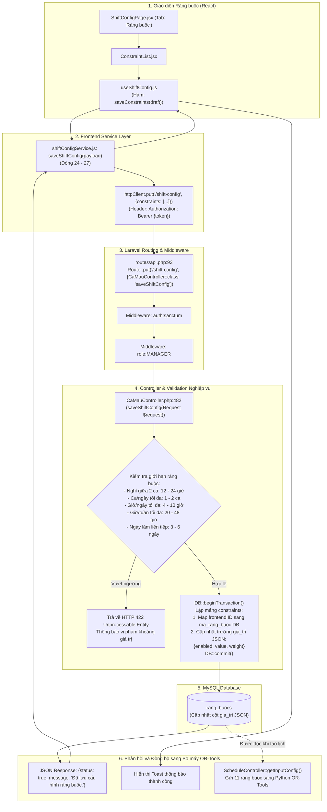

# SƠ ĐỒ ĐƯỜNG ĐI CODE: CẤU HÌNH RÀNG BUỘC XẾP LỊCH (CONSTRAINTS CONFIGURATION FLOW)

Tài liệu này mô tả chi tiết đường đi của code (**Code Flow**) từ giao diện Quản lý đến Backend Laravel và Database MySQL cho việc: **Hiển thị danh sách, Cập nhật giá trị, và Bật/tắt 11 ràng buộc xếp ca tự động**.

---

## 1. Sơ đồ tổng thể luồng Cấu hình Ràng buộc



---

## 2. Chi tiết từng bước thực thi trong Code

### 2.1. Phía Frontend React

1. **Hiển thị danh sách 11 ràng buộc:**
   - **File:** `smart-scheduling/src/pages/manager/shiftconfig/components/ConstraintList.jsx`.
   - **Giao diện:**
     - Chia 2 nhóm: **Ràng buộc cứng (Hard Constraints - Bắt buộc tuân thủ 100%)** và **Ràng buộc mềm (Soft Constraints - Ưu tiên tối ưu theo trọng số)**.
     - Mỗi hàng hiển thị: Tên ràng buộc, Nút bật/tắt (Toggle Switch), Ô nhập giá trị ngưỡng (Value Input), và Thanh kéo trọng số ưu tiên (Weight Slider đối với Soft Constraints).

2. **Lưu thay đổi ràng buộc:**
   - **File:** `smart-scheduling/src/pages/manager/shiftconfig/hooks/useShiftConfig.js`
   - **Vị trí:** Hàm `saveConstraints(draft)` tại **Dòng 216 - 217**:
     ```javascript
     const saveConstraints = (draft) =>
       persist(shifts, draft, generalSettings, "Đã lưu cấu hình ràng buộc.");
     ```
   - **Hàm `persist` (Dòng 111 - 123):**
     Gọi hàm `saveShiftConfig(...)` và gửi payload chứa mảng `constraints`.

3. **Cấu trúc dữ liệu Payload gửi đi:**
   ```json
   {
     "constraints": [
       {
         "id": "rest_between_shifts",
         "code": "REST_BETWEEN_SHIFTS",
         "name": "Nghỉ giữa hai ca",
         "category": "hard",
         "enabled": true,
         "value": 12
       },
       {
         "id": "max_shifts_per_day",
         "code": "MAX_SHIFTS_PER_DAY",
         "name": "Số ca tối đa trong ngày",
         "category": "hard",
         "enabled": true,
         "value": 1
       },
       {
         "id": "equal_hours_distribution",
         "code": "EQUAL_HOURS_DISTRIBUTION",
         "name": "Phân bổ giờ làm công bằng",
         "category": "soft",
         "enabled": true,
         "weight": 5.0
       }
     ]
   }
   ```

---

### 2.2. Phía Backend Laravel

1. **Khai báo Route:**
   - **File:** `Be_tao_lich/routes/api.php`
   - **Dòng 92 - 93:**
     ```php
     Route::middleware(['auth:sanctum', 'role:MANAGER'])->group(function () {
         Route::get('/shift-config', [CaMauController::class, 'getShiftConfig']);
         Route::put('/shift-config', [CaMauController::class, 'saveShiftConfig']);
     });
     ```

2. **Controller đọc cấu hình Ràng buộc (`getShiftConfig`):**
   - **File:** `Be_tao_lich/app/Http/Controllers/CaMauController.php`
   - **Vị trí:** Hàm `getFormattedConstraints()` tại **Dòng 390 - 423**.
   - **Xử lý:**
     - Truy vấn bảng `rang_buocs` loại trừ bản ghi hệ thống `GENERAL_SETTINGS`:
       ```php
       $records = RangBuoc::where('ma_rang_buoc', '!=', 'GENERAL_SETTINGS')->get();
       ```
     - Chuyển đổi mã Database sang định dạng Frontend bằng `RangBuoc::toFrontendId($r->ma_rang_buoc)`.
     - Giải mã trường JSON `gia_tri` để lấy `enabled`, `value`, `weight`.

3. **Controller lưu cấu hình Ràng buộc (`saveShiftConfig`):**
   - **File:** `Be_tao_lich/app/Http/Controllers/CaMauController.php`
   - **Vị trí:** **Dòng 482 - 620**
   - **Bước 1: Kiểm tra tính hợp lệ nghiệp vụ (Business Bounds Validation - Dòng 485 - 508):**
     Hệ thống quy định các ngưỡng bảo vệ sức khỏe nhân viên:
     ```php
     $bounds = [
         'rest_between_shifts'  => ['min' => 12, 'max' => 24, 'name' => 'Thời gian nghỉ tối thiểu giữa 2 ngày làm'],
         'max_shifts_per_day'   => ['min' => 1,  'max' => 2,  'name' => 'Số ca tối đa trong một ngày'],
         'max_hours_per_day'    => ['min' => 4,  'max' => 10, 'name' => 'Số giờ làm tối đa mỗi ngày'],
         'max_hours_per_week'   => ['min' => 20, 'max' => 48, 'name' => 'Số giờ làm tối đa mỗi tuần'],
         'max_consecutive_days' => ['min' => 3,  'max' => 6,  'name' => 'Số ngày làm liên tiếp tối đa'],
     ];
     ```
     Nếu Quản lý cố tình nhập số ngoài khoảng (ví dụ: nghỉ giữa 2 ca chỉ 8 tiếng hoặc làm 60 tiếng/tuần), server sẽ chặn lại và trả về HTTP `422` với thông báo tiếng Việt rõ ràng.

   - **Bước 2: Cập nhật Database (Dòng 580 - 615):**
     - Mở Transaction: `DB::beginTransaction()`.
     - Duyệt từng phần tử trong mảng `$rawConstraints`:
       - Tìm mã chuẩn `ma_rang_buoc` trong Database.
       - Cấu trúc lại dữ liệu JSON lưu trữ:
         ```php
         $valToStore = [
             'enabled' => $c['enabled'] ?? true,
         ];
         if (isset($c['value']))  $valToStore['value']  = $c['value'];
         if (isset($c['weight'])) $valToStore['weight'] = (float)$c['weight'];

         RangBuoc::updateOrCreate(
             ['ma_rang_buoc' => $dbCode],
             [
                 'gia_tri'   => json_encode($valToStore, JSON_UNESCAPED_UNICODE),
                 'trang_thai'=> $valToStore['enabled'] ? 'ACTIVE' : 'INACTIVE'
             ]
         );
         ```
     - Hoàn tất lưu trữ: `DB::commit()`.
     - Trả về JSON thành công kèm toàn bộ cấu hình mới nhất.

---

## 3. Danh sách 11 Ràng buộc được lưu trữ trong MySQL

Dưới đây là bảng đối chiếu chi tiết 11 ràng buộc thực tế trong bảng `rang_buocs`:

| STT | Mã Ràng Buộc (`ma_rang_buoc`) | Loại | Frontend ID | Giá trị mặc định | Ý nghĩa đối với Solver OR-Tools |
| :---: | :--- | :---: | :--- | :--- | :--- |
| 1 | `REST_BETWEEN_SHIFTS` | **HARD** | `rest_between_shifts` | `value: 12` (giờ) | Đảm bảo nhân viên nghỉ ít nhất 12 giờ trước khi sang ca ngày hôm sau |
| 2 | `MAX_SHIFTS_PER_DAY` | **HARD** | `max_shifts_per_day` | `value: 1` (ca) | Không phân công một nhân viên làm 2 ca trong cùng 1 ngày |
| 3 | `MAX_HOURS_PER_DAY` | **HARD** | `max_hours_per_day` | `value: 8` (giờ) | Giới hạn số giờ làm việc tối đa trong một ngày |
| 4 | `MAX_HOURS_PER_WEEK` | **HARD** | `max_hours_per_week` | `value: 40` (giờ) | Không xếp tổng thời gian làm quá 40 giờ/tuần |
| 5 | `MAX_CONSECUTIVE_DAYS`| **HARD** | `max_consecutive_days`| `value: 5` (ngày) | Không làm việc quá 5 ngày liên tục (phải có ngày nghỉ) |
| 6 | `MIN_STAFF_PER_SHIFT` | **HARD** | `min_staff_per_shift` | `enabled: true` | Đáp ứng đúng số lượng nhân viên cần thiết cho từng ca theo nhu cầu |
| 7 | `SKILL_BALANCE` | **HARD** | `skill_balance` | `enabled: true` | Đảm bảo đủ nhân viên có kỹ năng tương ứng (Role_Tag) trong ca |
| 8 | `EQUAL_HOURS_DISTRIBUTION` | **SOFT** | `equal_hours_distribution`| `weight: 5.0` | Tối ưu độ lệch giờ làm giữa các nhân viên cùng loại hợp đồng |
| 9 | `WEEKEND_FAIRNESS` | **SOFT** | `weekend_fairness` | `weight: 3.0` | Chia đều các ca làm việc vào Thứ 7 và Chủ nhật cho mọi nhân viên |
| 10 | `PREFER_STAFF_AVAILABILITY` | **SOFT** | `prefer_staff_availability` | `weight: 10.0` | Ưu tiên xếp ca theo đúng nguyện vọng lịch rảnh mà Staff đã đăng ký |
| 11 | `FIXED_SHIFT_PREFERENCE`| **SOFT** | `fixed_shift_preference` | `weight: 4.0` | Ưu tiên nhân viên làm ca cố định (quen ca) thay vì xoay ca liên tục |
| 12 | `GENERAL_SETTINGS` | **SYSTEM**| `generalSettings` | JSON cấu hình chung | Lưu hạn chót đăng ký (`availabilityDeadlineDay/Time`) và thời gian ân hạn |

