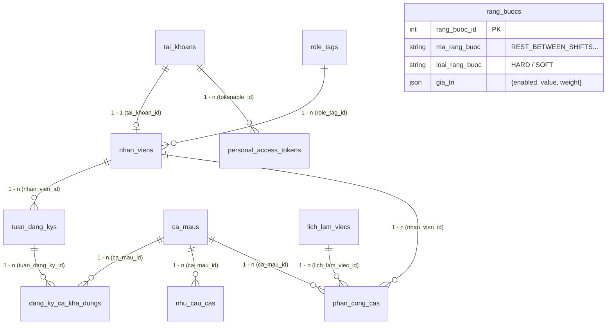

# BẢN ĐỒ TỔNG HỢP TOÀN BỘ ĐƯỜNG ĐI CODE (API - ROUTE - CONTROLLER - DATABASE MAP)

Tài liệu này tổng hợp toàn bộ các API thực tế của 3 nhóm chức năng cốt lõi trong hệ thống **Smart Scheduling**, chỉ rõ vị trí khai báo trong code từ Frontend React qua Router Laravel đến Model và Bảng MySQL.

---

## 1. Bảng Tổng hợp API Toàn diện

| STT | Chức năng | Frontend Service | HTTP Method | Endpoint | Backend Route (`routes/api.php`) | Controller & Method | Model Laravel | Bảng MySQL |
| :---: | :--- | :--- | :---: | :--- | :--- | :--- | :--- | :--- |
| **I** | **NHÓM 1: ĐĂNG NHẬP, ĐĂNG XUẤT & BẢO MẬT TOKEN** | | | | | | | |
| 1 | Đăng nhập hệ thống (Manager / Staff) | `authService.login(account, password, rememberMe)` | `POST` | `/api/auth/login` | Line 21 | `AuthController@login` | `TaiKhoan`, `NhanVien`, `PersonalAccessToken` | `tai_khoans`, `nhan_viens`, `personal_access_tokens` |
| 2 | Lấy thông tin tài khoản đang đăng nhập | `authService.getCurrentUser()` | `GET` | `/api/auth/me` | Line 30 | `AuthController@me` | `TaiKhoan`, `NhanVien` | `tai_khoans`, `nhan_viens` |
| 3 | Đăng xuất & Thu hồi Token | `authService.logout()` | `POST` | `/api/auth/logout` | Line 34 | `AuthController@logout` | `PersonalAccessToken` | `personal_access_tokens` |
| **II** | **NHÓM 2: STAFF ĐĂNG KÝ VÀ MANAGER XEM LỊCH RẢNH** | | | | | | | |
| 4 | Staff lấy thông tin lịch rảnh theo tuần | `availabilityService.getMyAvailability(params)` | `GET` | `/api/availability/my` | Line 39 | `AvailabilityController@getMyAvailability` | `NhanVien`, `TuanDangKy`, `DangKyCaKhaDung`, `CaMau`, `RangBuoc` | `nhan_viens`, `tuan_dang_kys`, `dang_ky_ca_kha_dungs`, `ca_maus`, `rang_buocs`, `lich_lam_viecs` |
| 5 | Staff gửi lưu phiếu đăng ký lịch rảnh / bận | `availabilityService.saveMyAvailability(payload)` | `POST` | `/api/availability/my` | Line 40 | `AvailabilityController@saveMyAvailability` | `TuanDangKy`, `DangKyCaKhaDung`, `CaMau`, `RangBuoc` | `tuan_dang_kys`, `dang_ky_ca_kha_dungs`, `ca_maus`, `rang_buocs` |
| 6 | Manager xem ma trận tổng hợp lịch rảnh cả tuần | `availabilityService.getWeeklyStaffAvailability(weekMonday)` | `GET` | `/api/availability/weekly` | Line 103 | `AvailabilityController@getWeeklyStaffAvailability` | `NhanVien`, `TaiKhoan`, `RoleTag`, `TuanDangKy`, `DangKyCaKhaDung`, `CaMau` | `nhan_viens`, `tai_khoans`, `role_tags`, `tuan_dang_kys`, `dang_ky_ca_kha_dungs`, `ca_maus` |
| **III** | **NHÓM 3: QUẢN LÝ CA MẪU VÀ RÀNG BUỘC XẾP LỊCH** | | | | | | | |
| 7 | Lấy cấu hình tổng hợp (Ca mẫu + Ràng buộc + Cấu hình chung) | `shiftConfigService.getShiftConfig()` | `GET` | `/api/shift-config` | Line 92 | `CaMauController@getShiftConfig` | `CaMau`, `RangBuoc`, `RoleTag` | `ca_maus`, `rang_buocs`, `role_tags` |
| 8 | Lưu cấu hình tổng hợp (Ca mẫu + Ràng buộc + Cấu hình chung) | `shiftConfigService.saveShiftConfig(payload)` | `PUT` | `/api/shift-config` | Line 93 | `CaMauController@saveShiftConfig` | `CaMau`, `RangBuoc` | `ca_maus`, `rang_buocs` |
| 9 | Lấy danh sách ca mẫu độc lập (RESTful) | `shiftConfigService.getShifts()` | `GET` | `/api/shifts` | Line 76 | `CaMauController@index` | `CaMau` | `ca_maus` |
| 10 | Thêm ca mẫu mới độc lập (RESTful) | `httpClient.post('/shifts', data)` | `POST` | `/api/shifts` | Line 77 | `CaMauController@store` | `CaMau` | `ca_maus` |
| 11 | Xem chi tiết ca mẫu theo ID | `httpClient.get('/shifts/{id}')` | `GET` | `/api/shifts/{id}` | Line 78 | `CaMauController@show` | `CaMau` | `ca_maus` |
| 12 | Cập nhật ca mẫu theo ID | `httpClient.put('/shifts/{id}', data)` | `PUT` | `/api/shifts/{id}` | Line 79 | `CaMauController@update` | `CaMau` | `ca_maus` |
| 13 | Tạm dừng trạng thái ca mẫu | `shiftConfigService.pauseShift(shiftId)` | `PATCH` | `/api/shifts/{id}/status` | Line 81 | `CaMauController@changeStatus` | `CaMau` | `ca_maus` |
| 14 | Xóa ca mẫu (Có kiểm tra dữ liệu lịch sử) | `shiftConfigService.deleteShift(shiftId)` | `DELETE` | `/api/shifts/{id}` | Line 82 | `CaMauController@destroy` | `CaMau` (`isUsedInSchedule`) | `ca_maus`, `nhu_cau_cas`, `phan_cong_cas`, `dang_ky_ca_kha_dungs` |
| 15 | Lấy danh mục chức danh / vai trò (Role_Tag) | `shiftConfigService.getRoleTags()` | `GET` | `/api/role-tags` | Line 97 | `CaMauController@getRoleTags` | `RoleTag` | `role_tags` |
| 16 | Thêm chức danh mới (Role_Tag) | `shiftConfigService.addRoleTag(roleName)` | `POST` | `/api/role-tags` | Line 98 | `CaMauController@storeRoleTag` | `RoleTag` | `role_tags` |
| 17 | Cập nhật tên chức danh (Role_Tag) | `shiftConfigService.updateRoleTag(oldRole, newRole)` | `PUT` | `/api/role-tags` | Line 99 | `CaMauController@updateRoleTag` | `RoleTag` | `role_tags` |
| 18 | Xóa chức danh (Role_Tag - Có kiểm tra khóa ngoại) | `shiftConfigService.deleteRoleTag(roleName)` | `DELETE` | `/api/role-tags` | Line 100 | `CaMauController@destroyRoleTag` | `RoleTag` | `role_tags`, `nhan_viens`, `nhu_cau_cas` |

---

## 2. Phân cấp Middleware và Cơ chế Bảo mật Tuyến đường

Toàn bộ hệ thống API trong `Be_tao_lich/routes/api.php` được chia thành **3 vành đai bảo mật**:

```
Vành đai 1: CÔNG KHAI (Public Routes)
│  Không yêu cầu Token
├── POST /api/auth/login
└── POST /api/admin/login
│
└── Vành đai 2: XÁC THỰC NGƯỜI DÙNG (Middleware: 'auth:sanctum')
    │  Bắt buộc Header: Authorization: Bearer <sanctum_token>
    │  Sanctum kiểm tra trong bảng MySQL: `personal_access_tokens`
    ├── GET  /api/auth/me
    ├── POST /api/auth/logout
    ├── GET  /api/availability/my       (Staff lấy lịch rảnh của mình)
    ├── POST /api/availability/my      (Staff gửi đăng ký lịch rảnh)
    │
    └── Vành đai 3: QUẢN TRỊ VIÊN (Middleware: 'role:MANAGER')
        │  CheckRole::class kiểm tra trường `vai_tro == 'MANAGER'` trong bảng `tai_khoans`
        │  Nếu Staff cố gọi vào -> Trả về HTTP 403 Forbidden
        ├── GET    /api/availability/weekly    (Manager xem lịch rảnh toàn bộ nhân viên)
        ├── GET    /api/shift-config          (Xem cấu hình ca & 11 ràng buộc)
        ├── PUT    /api/shift-config          (Lưu cấu hình ca & 11 ràng buộc)
        ├── GET    /api/shifts                (Danh mục ca RESTful)
        ├── POST   /api/shifts                (Thêm ca RESTful)
        ├── PUT    /api/shifts/{id}           (Sửa ca RESTful)
        ├── PATCH  /api/shifts/{id}/status    (Tạm dừng ca)
        ├── DELETE /api/shifts/{id}           (Xóa ca an toàn)
        ├── GET    /api/role-tags             (Xem danh mục vai trò)
        ├── POST   /api/role-tags             (Thêm vai trò)
        ├── PUT    /api/role-tags             (Sửa vai trò)
        └── DELETE /api/role-tags             (Xóa vai trò)
```

---

## 3. Bản đồ quan hệ các Bảng Database (Database Relationships)



---

## 4. Hướng dẫn kiểm tra và tra cứu nhanh trên IDE

Khi bạn mở dự án trong VS Code, bạn có thể dễ dàng kiểm tra bất kỳ luồng nào bằng cách:
1. **Frontend:** Bắt đầu từ thư mục `smart-scheduling/src/pages/` $\rightarrow$ tìm hàm `handleSubmit` hoặc `useEffect`.
2. **Service trung gian:** Mở `smart-scheduling/src/services/` (chứa các cuộc gọi Axios với URL chính xác).
3. **Route Laravel:** Mở `Be_tao_lich/routes/api.php` $\rightarrow$ tìm đường dẫn endpoint tương ứng.
4. **Logic Controller:** Mở `Be_tao_lich/app/Http/Controllers/` $\rightarrow$ tìm method thực thi.
5. **Database Model:** Mở `Be_tao_lich/app/Models/` $\rightarrow$ đối chiếu với các bảng tương ứng trong cơ sở dữ liệu MySQL `smart_scheduling`.

